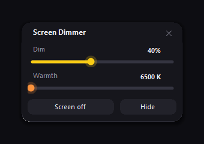

# Screen Dimmer

A tiny, dependency-free screen dimmer for Windows 10/11.

It darkens the display **below the hardware minimum** and shifts its colour
temperature towards warm — the two things the built-in brightness slider
cannot do. Useful at night, in a dark room, or when you want a warm,
low-blue-light screen.



## Why another dimmer?

| | Windows brightness slider | Screen Dimmer |
|---|---|---|
| Minimum brightness | hardware floor | almost black (95 %) |
| Colour temperature | fixed | 6500 K → 2700 K (warm) |
| Click-through overlay | — | yes, nothing is blocked |
| Footprint | — | ~30 MB RAM, no installer, no admin rights |

## Features

- **Dim** 0–95 % on top of the hardware brightness.
- **Warmth** 6500 K (neutral) → 2700 K (warm), like a night-light for the screen.
- **Screen off** — turns the monitor off while the session keeps running
  (any key or mouse move brings it back).
- **Global hotkeys**, works while the panel is hidden.
- **Tray icon**, remembers your settings and the panel position.
- **Start with Windows** (optional, one click in the tray menu).
- Multi-monitor aware, DPI aware, single instance.

## Quick start

1. Download `ScreenDimmer.exe` from [Releases](../../releases).
2. Run it. The panel appears in the bottom-right corner.
3. Drag the sliders, or use the hotkeys.

Nothing to install: it targets .NET Framework 4.x, which ships with Windows.
No admin rights, no background services, no network access.

## Hotkeys

| Shortcut | Action |
|---|---|
| `Ctrl+Alt+↓` / `Ctrl+Alt+↑` | dimmer / brighter (5 % steps) |
| `Ctrl+Alt+→` / `Ctrl+Alt+←` | warmer / cooler |
| `Ctrl+Alt+O` | turn the screen off |
| `Ctrl+Alt+D` | show the panel |
| `Ctrl+Alt+Q` | quit |

## How it works

Each monitor gets two layered, click-through windows
(`WS_EX_LAYERED | WS_EX_TRANSPARENT`, `WM_NCHITTEST → HTTRANSPARENT`):

1. a black layer that lowers brightness;
2. an amber layer above it that shifts the white point towards warm.

Using two layers instead of one keeps the two controls independent: warmth
still reads at strong dimming levels. Everything is plain GDI/WinForms —
no drivers, no gamma-ramp hacks, so a crash can never leave your screen
stuck in an odd colour.

Screen-off uses the standard `WM_SYSCOMMAND` / `SC_MONITORPOWER` broadcast.

## Settings

Stored in `%APPDATA%\ScreenDimmer\settings.txt` (`level`, `warm`, `x`, `y`).
A small log lives next to it as `dimmer.log`.

## Build from source

```bat
build.cmd
```

which calls the C# compiler that ships with .NET Framework and writes
`dist\ScreenDimmer.exe`. The equivalent one-liner:

```powershell
C:\Windows\Microsoft.NET\Framework64\v4.0.30319\csc.exe /target:winexe `
  /out:dist\ScreenDimmer.exe `
  /reference:System.Windows.Forms.dll /reference:System.Drawing.dll `
  src\ScreenDimmer.cs
```

`build.ps1` does the same for CI and PowerShell users (run it with
`powershell -ExecutionPolicy Bypass -File build.ps1` if script execution is
restricted on your machine).

CI builds the same binary on every push and attaches it to tagged releases.

## Limitations

- It dims the picture, not the backlight: it does not save power the way
  lowering hardware brightness does.
- Warmth is a coloured overlay, so at maximum settings dark areas take a
  slight sepia tint — the usual trade-off of overlay-based dimmers.
- It does not cover the Windows sign-in screen or exclusive full-screen games.

## License

MIT — see [LICENSE](LICENSE).
